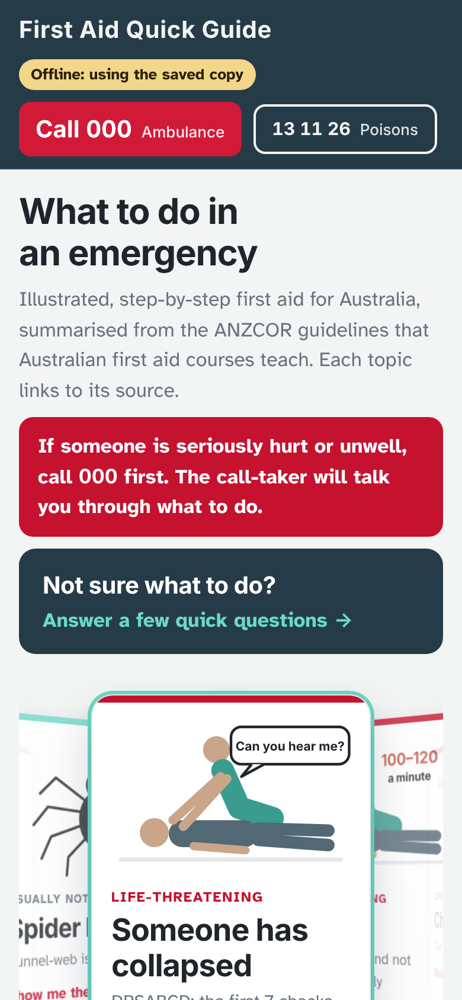
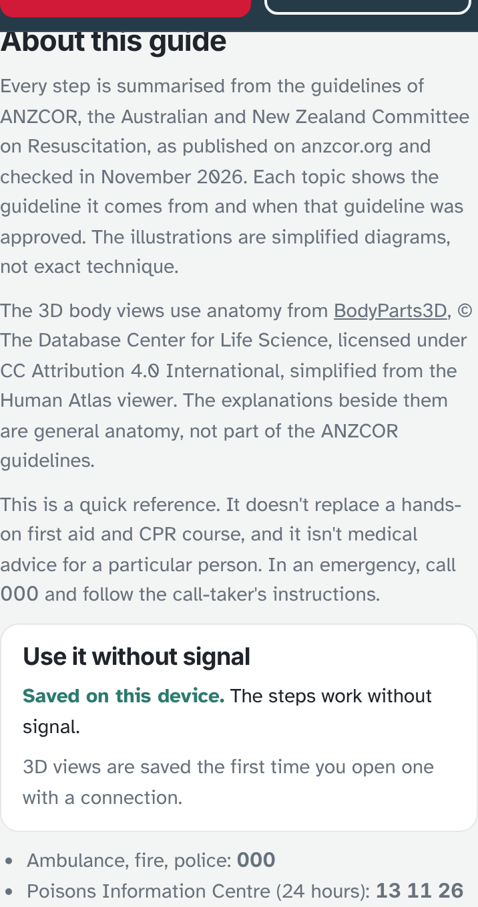
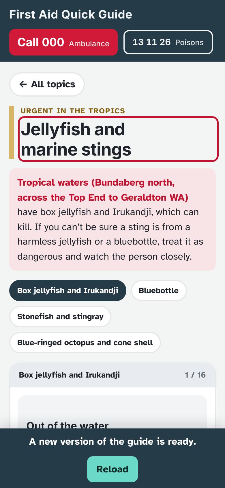

# PWA Acceptance Report

Stage 1 of the enhancement brief: installable app and offline core. Branch `pwa-offline`, based on `main` at `00e83fb`.

**Result: 31 of 31 automated checks passed.** No clinical content changed: `src/topics.js`, `src/flow.js` and `src/art.js` are identical to the baseline commit. Real-device testing is still to do (section 4).

## 1. Test environment

| Item | Value |
|---|---|
| Browser | Google Chrome (headless), via Playwright for Python |
| 3D | SwiftShader software WebGL |
| Server | Python `http.server`, with the repo served at `/first-aid-quick-guide/` to match GitHub Pages; `Cache-Control: no-cache` |
| Network | Every host except the test server blocked, to prove the app needs nothing external |
| Viewport | 390 × 844 at 2× (phone size) |
| Command | `python3 src/build.py && python3 tests/browser_tests.py --pwa --json docs/acceptance/results.json --shots docs/acceptance` |
| Raw results | [`acceptance/results.json`](acceptance/results.json) |

## 2. Results against the brief's acceptance criteria

| Brief criterion (§4.5) | Test | Result |
|---|---|---|
| Application loads after first successful online visit | Service worker controls the page, scope `/first-aid-quick-guide/` | **Pass** |
| Application opens in airplane mode | Opens with no network | **Pass** |
| Search continues to work offline | "snake" filters to one topic offline | **Pass** |
| All existing topics remain accessible | All 16 topics and their illustrations offline | **Pass** |
| CPR beat remains functional offline | Counter advances offline | **Pass** |
| Illustrations remain available offline | Checked on all 16 topics | **Pass** |
| Anatomy views work offline if their dependencies have been cached | 3D opened once online, then offline | **Pass** |
| Failed 3D loading does not affect first aid instructions | Model blocked: clear message, steps still work | **Pass** |
| Updates don't leave a broken mix of old and new assets | New version waits behind a "Reload" bar; tapping it activates the new version and deletes the old cache | **Pass** |

### Additional checks

| Area | Test | Result |
|---|---|---|
| Manifest | Loads; `start_url` and `scope` `./`; `display` standalone | Pass |
| Offline label | Shows offline; clears when back online | Pass |
| Fonts | Inter and Atkinson Hyperlegible render with no network | Pass |
| Deep links | `#heart` opens offline in a new tab | Pass |
| Query strings | `index.html?utm=x#stroke` falls back to the saved page offline | Pass |
| Interrupted install | One file blocked during install: page works online, nothing half-saved, next visit installs | Pass |
| Cleared cache | Caches deleted under a live worker: still loads online, re-saves itself, works offline again | Pass |
| No worker allowed | Service workers blocked, as in the Claude artifact frame: app works with no errors | Pass (separate check) |
| External requests | None made (Google Fonts and jsDelivr gone) | Pass |
| Regression | All 11 Stage 0 checks (carousel, search, 16 topics, list view, refresh on topic URL, question flow, CPR beat, 3D, reduced motion, no JS errors) | Pass |
| Build | Refuses to build with a syntax error or a broken flow link (both tried) | Pass |

## 3. Screenshots

| Offline home (label in bar) | Saved status in footer | Update bar |
|---|---|---|
|  |  |  |

The update bar screenshot was made by showing the bar by hand. The automated update test triggered it for real.

## 4. Not yet tested (needs the owner, on devices)

| Test | Why it matters |
|---|---|
| Install on Android Chrome from the footer button, open from the home screen in airplane mode | Install prompts don't appear in headless browsers |
| Add to Home Screen on iPhone Safari, open in airplane mode | Safari's offline and storage rules differ from Chrome's |
| A real update on GitHub Pages: open the app, push a commit, see the bar, tap Reload | Pages caches files for about 10 minutes, so timing differs from the local test |
| Tablet and desktop install | Window sizes and install flows |
| Screen reader pass over the new offline label, update bar and install button | Automated scans can't judge how they sound |

## 5. Known issues and limits

1. **Updates aren't instant.** New content, including clinical corrections, reaches a user when they tap Reload or next open the app with no tabs running. That's deliberate, so nothing changes mid-emergency.
2. **3D isn't saved until used.** Opening 3D needs a connection the first time (about 1.2 MB). The panel says so.
3. **iOS can clear saved data** for sites that haven't been used for a few weeks. Installed home-screen apps are kept longer. If iOS clears it, the next online visit saves it again.
4. **Arrows (→ ←) use the system font.** The self-hosted fonts are the Latin subset, which doesn't include arrows, as it was with Google Fonts.
5. **The Claude artifact copy doesn't get offline support**, because that host blocks service workers. GitHub Pages is the offline version.
6. **Stage 0 accessibility findings are still open:** muted text contrast, the dark-theme "when to call" red, a heading level, and 37 px chips. Stage 6 covers these.
7. **The CPR beat still uses `setInterval`.** It works offline, but timing can drift and it slows in a background tab. Stage 5 covers this.

## 6. Outstanding work (next stages)

- Stage 2: per-topic source and review register; a qualified reviewer signs off every topic, drawing, 3D caption and the question flow wording.
- Stage 3: question flow diagram; run the structure and browser tests in GitHub Actions on every pull request.
- Stage 5: CPR beat on Web Audio timing, mute, larger display.
- Stage 6: accessibility fixes and real-device testing.
