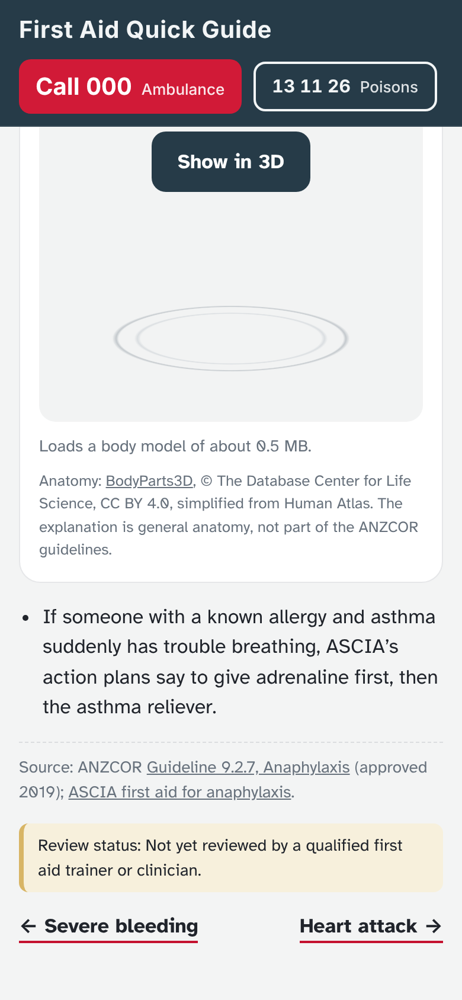

# Stage 2 Acceptance Report: Clinical Governance

Branch `clinical-governance`, stacked on `pwa-offline` (Stage 1, PR #1). 15 November 2026.

**Result:** the governance structure is in place and enforced by the build. All 16 topics and 3 components are recorded as `CLINICAL REVIEW REQUIRED`. **No clinical content was changed.** The stage can't be completed without a person: a qualified reviewer must review the content, and the owner must record it.

## Deliverables against the brief (§5)

| Brief requirement | Delivered | Where |
|---|---|---|
| 5.1 Source hierarchy | Recorded and documented | `data/clinical-sources.json` (`hierarchy`), `docs/CLINICAL_GOVERNANCE.md` §2 |
| 5.2 Structured clinical metadata per topic | 19 sources with version, amendments and last-checked dates; sources mapped to each topic and component | `data/clinical-sources.json` |
| 5.3 Controlled review statuses | The 7 statuses from the brief, with entry rules enforced by the build | `data/topic-reviews.json`, `tests/validate_governance.mjs` |
| 5.3 Don't treat a source check as approval | Approval needs a named reviewer, qualification, date, a person confirming the source check, and no open HIGH findings | `tests/validate_governance.mjs` |
| 5.4 Steps 1–4: statements, sources, latest version, comparison | Every statement compared with its live source (AI-assisted, needs human confirmation) | `docs/clinical-review/SOURCE_CHECK_2026-11.md`, `data/source-findings.json` |
| 5.4 Steps 5–7: discrepancies and proposed corrections | 40 findings (3 HIGH, 14 MEDIUM, 23 LOW), each with a proposed change | same |
| 5.4 Step 8: qualified review | Review pack with every item, drawing, finding and sign-off field | `docs/clinical-review/REVIEW_PACK.pdf` (41 pages) and `.md` |
| 5.4 Steps 9–10: record reviewer, publish only after approval | Fields and rules in place; nothing marked reviewed | `data/topic-reviews.json` |
| 5.4 Don't silently rewrite content | `src/topics.js`, `src/flow.js`, `src/art.js` unchanged | git diff against `00e83fb` |
| 5.5 Source currency | Version and amendment dates, ANZCOR 2025–2026 updates checked, monthly and 12-monthly process, 12-month staleness warning | `docs/CLINICAL_GOVERNANCE.md` §6, build warning |

Also: each topic and the question flow now show their review status in the app (screenshot below).

## Tests

| Check | Result |
|---|---|
| Governance: every topic and component recorded, valid statuses, sources registered, app source links match the register | Pass |
| Governance rules refuse unsafe records: approval with missing reviewer, unconfirmed source check, open HIGH finding, or missing approval details (tried on "poison") | All four refused |
| Governance rule refuses an app source link missing from the register (tried on "anaphylaxis") | Refused |
| Build runs the governance check and stops on failure | Pass |
| Browser suite: Stage 0 and Stage 1 checks plus "review status shows on topics and the question flow" | 32 of 32 passed (`acceptance/results.json`) |

## HIGH findings (for the reviewer first)

- **F01 Anaphylaxis device:** ASCIA's 2026 plans cover four devices (EpiPen, Anapen and Jext injectors, neffy nasal spray) and general use devices for people without their own. The app describes only EpiPen or Anapen into the thigh.
- **F02 Anaphylaxis:** ASCIA says "if in doubt, give adrenaline device". The app doesn't say this.
- **F07 Button battery:** ANZCOR 9.5.1 says nothing by mouth if there's difficulty breathing *or bleeding*. The app's honey and jam step doesn't mention bleeding.

These are live on the current site. Fixing them needs a reviewer's agreement (brief §5.4 and §14), then a separate "Clinical change" pull request.

## Corrections after second review (15 November 2026)

Another reviewer's critique of this pull request was assessed point by point. Changes made:

| Point | Change |
|---|---|
| F01 missed Jext | F01 finding and draft wording now cover EpiPen, Anapen, Jext and neffy, and general use devices with the ASCIA First Aid Plan. ASCIA's device instructions page added to the source register. The wording remains a draft for the reviewer. |
| Build check is not a publication gate | New `tests/release_gate.mjs`, separate from the build. Blocks unless every item is approved, unchanged since approval (content hash), every finding is decided and sources were checked in the last 45 days. Tested: blocks now (59 issues); passes on a simulated full approval; blocks again after a one-character change to the CPR rate; blocks when the source check is stale. |
| Evidence versus clinical judgement | Each finding now has a `basis`: `source` or `judgement` (16 findings). Shown in the review pack. The reviewer is asked to judge whether each item suits a general Australian audience, not only whether it matches the source. F20 stays `source` (the guideline states it), but its proposal was incomplete and now includes hydrogel dressings. |
| Reviewer qualifications | Tightened in `docs/CLINICAL_GOVERNANCE.md` and the review pack: accredited first aid trainer with current practice preferred; otherwise a clinician whose current work involves first response or first aid training; general registration alone is not enough; must review drawings and the flow. |

Still no clinical content changed: `src/topics.js`, `src/flow.js` and `src/art.js` are identical to `00e83fb`.

## Follow-up implementation after review

The follow-up recommendations were converted into a Stage 2-only implementation task and recorded in `docs/clinical-review/STAGE2_REVIEW_ACTIONS.md`.

- F01 already covers EpiPen, Anapen, Jext and neffy, as well as general-use devices and the ASCIA plan. This remains a draft for the reviewer; no app instruction was changed.
- Reviewer criteria now require current topic-relevant competence, an explicit scope check, referral to a second reviewer where needed, and private verification of credentials. A reusable checklist is in `docs/clinical-review/REVIEWER_SCOPE_CHECKLIST.md`.
- The release gate remains separate from the normal build. A GitHub Actions workflow now runs on pull requests targeting `main` and the Stage 1 base branch `pwa-offline`. It checks that `index.html` and `sw.js` match `src/`, then runs the release gate in per-item mode: any item whose content or approval record changed must be approved and match its approved hash; unchanged items aren't required to be approved yet.
- Configured 15 November 2026: a branch protection rule on `main` requires the `release-gate` check (GitHub Actions), with no bypass for administrators and no force pushes or deletion.

## Known limits

1. The source check was AI-assisted. A person must confirm it (`sourceCheck.confirmedBy`) before any topic can be marked reviewed.
2. The ASCIA page couldn't be fetched directly; it was checked through ASCIA's published 2026 plan PDFs.
3. The drawings and 3D captions have no clinical source by nature. They need reviewer approval (F38, F40).
4. Reviewer names are kept in the repo's records, not shown in the app. If the reviewer prefers not to be named in a public repo, record a role and keep the signed pack privately.
5. The required check only reports on pull requests whose merge result contains the workflow. PR #1 is blocked until PR #2 is merged into `pwa-offline`; then PR #1 picks up the workflow. Branch protection does not cover the GitHub Pages source setting itself: anyone with admin access can still repoint Pages to another branch.
