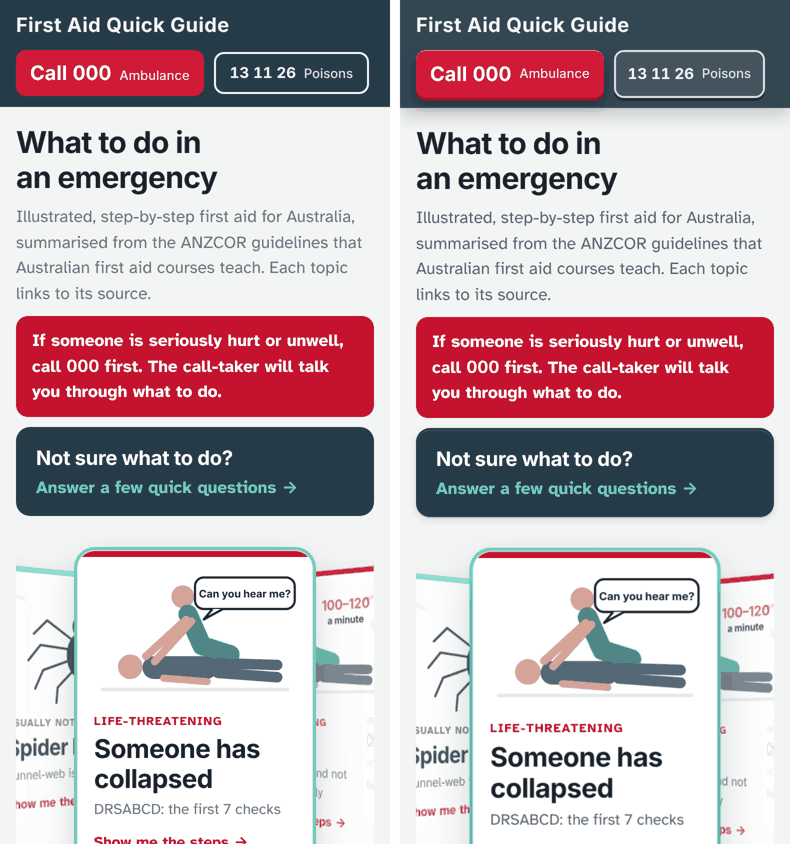
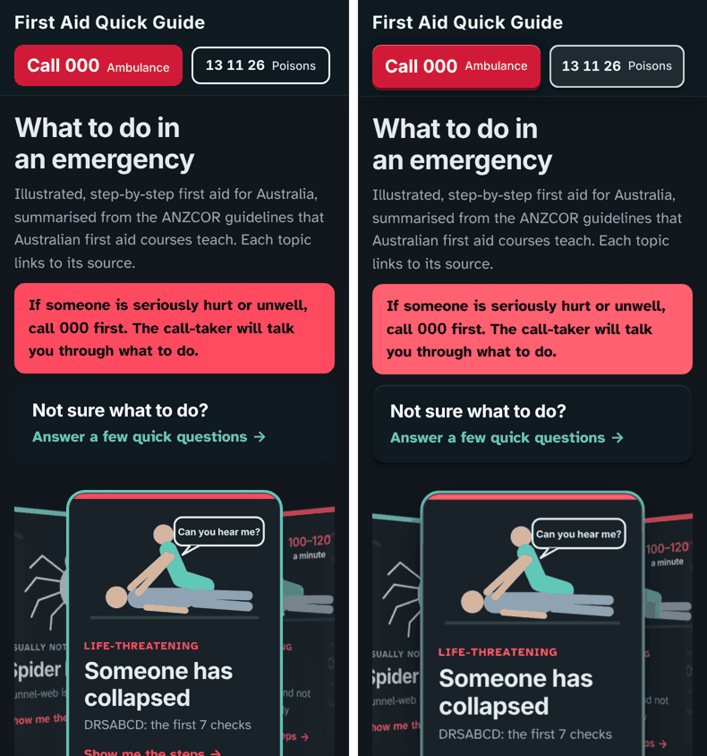
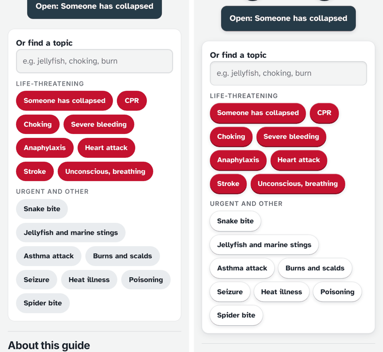
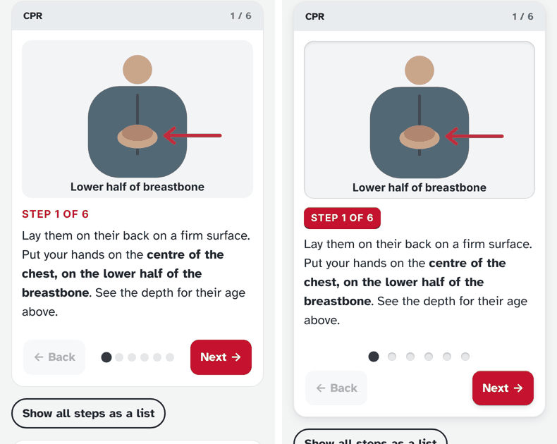
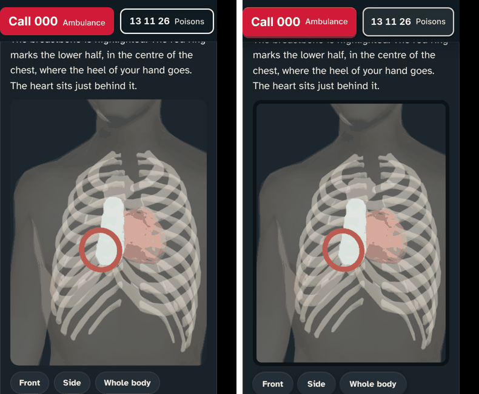
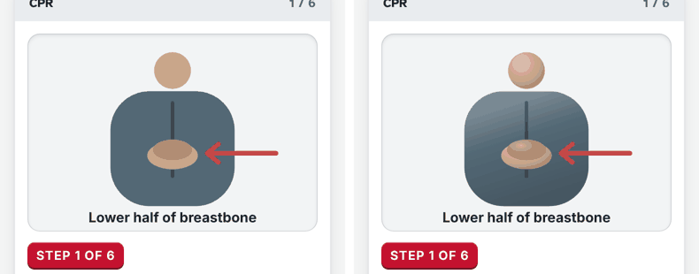
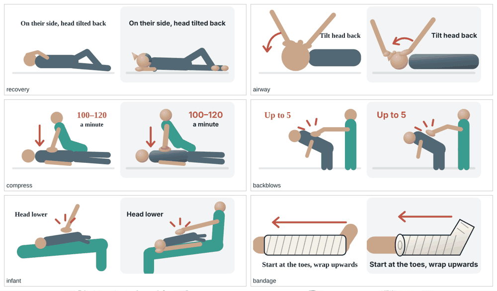

# Tactile spatial UI (Stage: UI polish)

A depth layer on the existing design: raised surfaces, pressable keys, a lifted topic deck and a recessed 3D viewport. No first aid text, step, drawing, source link, attribution or phone number changed. The release gate reports no clinical item changed.

## What changed

| Area | Change | Where |
|---|---|---|
| Tokens | `--ease-spring`, `--hl` (top highlight), `--shadow-card`, `--shadow-key`, `--shadow-floating`, `--shadow-pressed`, `--well`, `--bezel`, with dark versions | `src/style.css` `:root` |
| Emergency bar | 94% opaque slate with a 12px blur behind; opaque if blur is unsupported or reduced transparency is set. Call 000 and 13 11 26 are keys with a top highlight, a 3px base and a drop shadow; pressing moves them 2px down. 48px tall. | `src/style.css`, "Tactile spatial layer" |
| Topic deck | Active card lifted 40px towards the viewer with a floating shadow. Mouse: tilts up to about 5 degrees towards the pointer. Touch: leans with the drag before the swipe turns the deck. Both spring back. | `src/app.js` (tilt hooks), `src/style.css` |
| Search and chips | Search is a recessed well with a raised focus ring. Chips are keys: rise on hover, sink when pressed. | `src/style.css` |
| Steps | Player and list items are raised tiles; "Step 1 of 6" and list numbers are keycap badges; drawings sit in shallow wells. | `src/style.css`, `src/app.js` (list number badge) |
| 3D anatomy | Viewport has a 6px bezel and inner shadow. Front, Side and Whole body are pills that stay pressed for the current view (`aria-pressed`). | `src/style.css`, `src/viewer.js` |

## Accessibility fixes found on the way

The axe scan before this change found existing failures. All are fixed:

- **Contrast:** `--muted` text was 4.44:1 on the page background (needs 4.5). Now `#5b6570`, at least 5.0:1 on every surface it sits on. In dark mode, the red "Start CPR" text on the pink "when" box was 4.31:1; dark `--alarm` is now `#ff6170` (4.85:1).
- **Target size:** step dots were 12px targets. Now 24px buttons with the 12px dot drawn inside; on narrow screens the dots get their own row so they don't wrap.

After: no contrast or target-size violations in light or dark, mobile or desktop, on home, CPR and the question flow. One best-practice note remains from before (the focusable carousel has no widget role).

## Parts of the brief not followed as written

| Brief | What was done instead | Why |
|---|---|---|
| Frosted glass header (`backdrop-filter: blur(12px)`) | Kept, but 94% opaque, not see-through glass | A mostly transparent bar lets scrolled content sit behind "000". At 94% the bar text stays at 8.8:1 or better even over a white page. |
| Card highlight `1px solid rgba(255,255,255,.4)` | An inset top highlight token, strong in light mode and faint in dark | A white border is invisible on white cards in light mode. |
| Side cards `scale(0.92)` with slight `rotateY` | Existing geometry kept (recede 170px per step, turn 40 degrees) | The recession already scales them to about 0.87 of full size; another 0.92 on top would shrink them further for no gain. |
| Tilt on touch | Lean with the drag instead | Touch has no hover; tilting under a resting finger fights the swipe. |
| WCAG AAA | AA met everywhere; AAA (7:1) not attempted for secondary text | AAA for muted text would flatten the visual hierarchy. Body text and the bar text exceed 7:1. White on the Call 000 red is 5.4:1, which passes AA for its large bold text; reaching 7:1 would mean a much darker red. |

## Motion and fallbacks

- `prefers-reduced-motion: reduce`: flat scrolling deck (unchanged), no tilt or lean, no transitions; press states change instantly.
- `prefers-reduced-transparency: reduce`: opaque emergency bar.
- `forced-colors: active` (Windows high contrast): keys and inputs get real borders, since shadows are dropped.

## Tests

- Build, structure and governance checks: pass. Release gate (per item, against the base branch): no clinical item changed.
- Browser suite (`tests/browser_tests.py --pwa`): 32 of 32.
- Extra interaction checks: mouse tilt sets and clears; arrow keys still turn the deck; a touch drag leans the card, the swipe turns it, and the lean resets; reduced motion keeps the flat deck; step dots are 24px on one row at 390px wide.
- Size: `index.html` grows by about 3.3 KB gzipped.

## Before and after (left: before, right: after)

## Illustration lighting and 3D colour key (follow-up PR)

- **Lighting:** every filled shape in the 57 drawings is painted with a gradient lit from the upper left (heads as spheres, clothing, bandages, water, wood, warning signs). The gradients live in one hidden `<svg>` added by `src/app.js` and use CSS colour variables, so they follow light and dark mode. Each fill keeps its flat colour as a fallback. **`src/art.js` is unchanged**: no drawing shows anything different, so the release gate reports no clinical change. Strokes (limbs, arrows) stay flat because a gradient on a straight line has no height and would disappear.
- **Ground line:** now a soft contact shadow instead of a grey rule.
- **3D colour key:** under each 3D view, a swatch for every colour in the model, with names from the BodyParts3D parts used (for example "Breastbone (sternum), highlighted", "Outer thigh muscle (vastus lateralis)"). The marker ring is listed as "the spot described above", so the key adds no instruction of its own.
- **Drawings stay `aria-hidden`:** each sits next to the step text it illustrates. Giving them `role="img"` and a title would make screen readers read every step twice.

## Six drawings redrawn (clinical change, waits for review)

Recovery position, head tilt, CPR compressions, adult back blows, infant back blows and the pressure bandage were redrawn as flat side or front views (no isometric projection, so angles stay exact). The label text on each is unchanged. Recorded as finding **F41** for the reviewer; the review pack now shows the new drawings. The release gate blocks this from reaching `main` until the drawings are approved.

